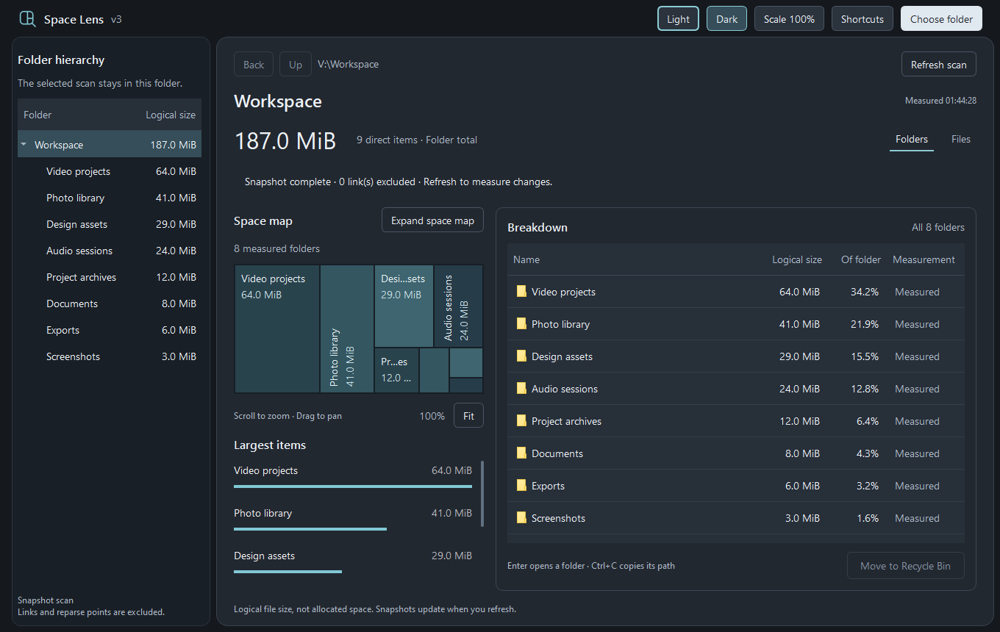
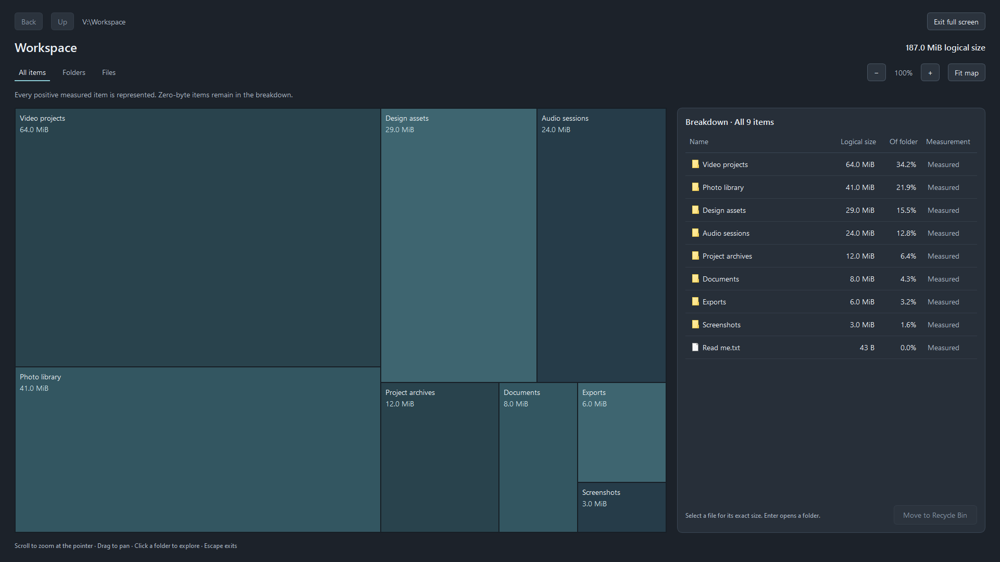
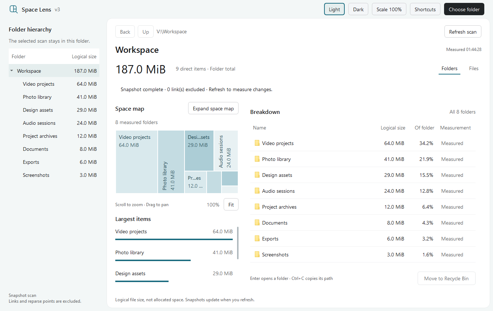

# Space Lens v3

See where your folder space goes. Space Lens is a Windows desktop app with an interactive space map, a folder hierarchy, and a detailed size breakdown.




## Explore your storage

- **See the largest items.** Compare folders and files by logical size and percentage of the selected folder.
- **Explore the space map.** Scroll to zoom at the pointer, drag to pan, and click a folder to explore its contents.
- **Expand the view.** Open a full-screen map with its own complete breakdown, file and folder filters, and zoom controls.
- **Make it comfortable.** Switch between light and dark mode. Adjust interface scale from 85% to 150% with the slider or percentage field, and choose reduced motion.
- **Keep track of a scan.** See progress while folders are measured, cancel a scan, or refresh the snapshot after making changes.
- **Move items to Recycle Bin.** Select a file or folder in the breakdown, choose **Move to Recycle Bin**, and confirm. Restore items through Windows Recycle Bin.

## Full-screen space map



Scroll to zoom, drag to pan, and use **Fit map** to return to the overview. **Back** and **Up** let you navigate through the scanned folder. Press **Escape** to exit full screen.

## Light mode



The demo and screenshots use sample files and folders.

## Download and run

Download `Space Lens v3.exe` from this repository's **Releases** page and open it on Windows 10 or 11 (64-bit). The standalone executable does not require a separate Python installation.

Choose a folder to begin. Folder sizes are snapshots of logical file size, rather than allocated disk space; use **Refresh scan** to measure changes. Links and junctions are skipped, and unreadable items are identified in the scan details.

## Keyboard shortcuts

| Shortcut | Action |
| --- | --- |
| Enter | Open the selected folder |
| Alt + Left | Go back |
| Alt + Up | Go to the parent folder |
| Ctrl + C | Copy the selected item's path |
| Delete | Request a move to Recycle Bin |
| + / − | Zoom the focused space map |
| 0 | Fit the space map |
| Escape | Exit the expanded map |

The **Shortcuts** button in the app lists the available shortcuts.

## Build from source

Requires Windows 10 or 11 (64-bit) and [uv](https://docs.astral.sh/uv/getting-started/installation/).

From the repository folder in PowerShell:

```powershell
.\Setup.ps1
.\Build.ps1
```

Setup creates a Python 3.14.6 environment and installs the pinned dependencies. The build produces the standalone executable at `dist\Space Lens v3.exe` using PyInstaller.

To run the source after setup:

```powershell
.\.venv\Scripts\python.exe app.py
```

## Third-party components

Built with Python, Qt for Python (PySide6 Essentials), and PyInstaller. See [third-party notices](THIRD_PARTY_NOTICES.md) and the component license texts in [licenses](licenses).
